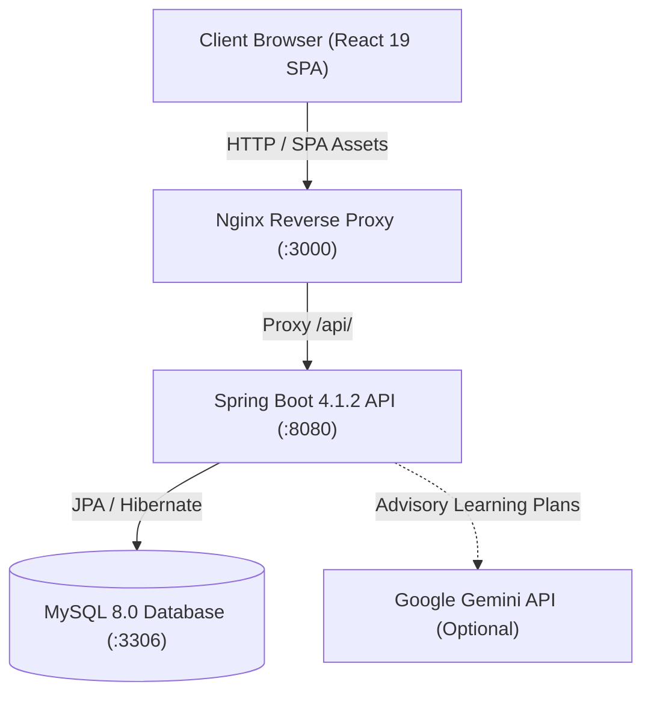

# CampusBridge

A role-based campus recruitment and placement management platform featuring rule-based eligibility evaluation, lifecycle state enforcement, and advisory skill gap roadmaps.

[](https://github.com/sanketamte96k/Campus-Bridge/actions/workflows/ci.yml)

Continuous integration runs automated verification on every push and pull request to `main`. It validates the Spring Boot test suite against a MySQL 8 service container, executes frontend linting, unit tests, and production builds, and builds container images.

---

## What it does

### Student
- Maintain an academic profile with engineering branch, CGPA, active backlogs, and technical skills.
- Browse campus job vacancies with real-time, criterion-by-criterion eligibility status.
- Apply to eligible vacancies with single-active application enforcement and withdraw while pending review.
- Inspect deterministic skill gaps for ineligible jobs and generate advisory learning roadmaps.

### Recruiter
- Post job vacancies with specific eligibility criteria (allowed branches, minimum CGPA, backlog limit, required skills).
- Review job applicants with automated eligibility verification summaries.
- Advance candidates through recruitment stages (Applied, Shortlisted, Selected, Rejected) via an enforced state machine.
- Monitor active placement drives, total application counts, and candidate pipeline distribution.

---

## Screenshots

*Note: Screenshot image files (`01-...png` through `06-...png`) are not currently committed to `docs/screenshots/`. To generate them, run the platform locally or in Docker and capture the student job search, eligibility breakdown, skill gap roadmap, recruiter posting, and applicant review interfaces.*

---

## Highlights

- **Rule-based eligibility engine:** Evaluates department, CGPA, backlogs, and technical skills as a pure function in both Java and TypeScript, returning individual pass/fail reasons for each criterion.
- **Enforced status state machine:** Application progression (Applied, Shortlisted, Selected, Rejected, Withdrawn) is strictly governed by an immutable transition map in the service layer, preventing invalid or backwards lifecycle jumps.
- **Single active application rule:** Database-level `UNIQUE (job_id, user_id)` constraint prevents concurrent duplicate submissions, with in-place row reactivation when reapplying after withdrawal.
- **Advisory AI skill-gap roadmaps:** Deterministic gap calculation feeds an optional Gemini LLM workflow with zero PII transmission, input sanitization, JSON schema enforcement, sliding-window rate limiting, and an offline template fallback.
- **Layered security model:** BCrypt password hashing, stateless HMAC-SHA256 JWT authorization, Spring Security method-level role checks, and database-verified record ownership on recruiter operations.

---

## Architecture



In containerized deployments, Nginx acts as a single-origin reverse proxy on port 3000, serving compiled React production assets and routing `/api/` traffic directly to the Spring Boot backend (`http://backend:8080`), eliminating the need for CORS. Spring Boot executes Flyway migrations on startup against MySQL 8, exposes RESTful endpoints, and interacts with an optional external Gemini API strictly for non-sensitive skill gap advice.

---

## Tech stack

| Layer | Technology |
| :--- | :--- |
| **Frontend framework** | React 19, TypeScript |
| **Frontend build tool** | Vite 8 |
| **Routing & state** | React Router v7, TanStack Query v5 |
| **Styling** | Tailwind CSS v4 |
| **Backend framework** | Spring Boot 4.1.2 (Java 21 LTS) |
| **Security & auth** | Spring Security, JJWT (HMAC-SHA256) |
| **ORM & persistence** | Spring Data JPA, Hibernate ORM 7.4 |
| **Database migrations** | Flyway |
| **Database engine** | MySQL 8.0 |
| **AI advisory client** | Spring RestClient (Google Gemini 2.5 Flash API) |
| **Reverse proxy** | Nginx (Alpine) |
| **Testing** | Vitest, Oxlint (Frontend); JUnit 5, Mockito (Backend) |

---

## Getting started

### Environment variables

The application reads configuration values from the environment or a root `.env` file (copied from `.env.example`):

| Variable | Description | Example / Default |
| :--- | :--- | :--- |
| `DB_USERNAME` | MySQL database username | `campusbridge_user` |
| `DB_PASSWORD` | MySQL database password | `your-db-password` |
| `JWT_SECRET` | HMAC-SHA256 signing secret key (minimum 32 characters) | `your-secure-random-jwt-secret-at-least-32-chars-long` |
| `DB_URL` | JDBC database URL (optional) | `jdbc:mysql://localhost:3306/campusbridge` |
| `PORT` | Server HTTP port (optional) | `8080` |
| `SPRING_PROFILES_ACTIVE` | Active Spring profile (optional) | `dev` |
| `CORS_ALLOWED_ORIGINS` | Allowed CORS origins for standalone backend (optional) | `http://localhost:5173,http://localhost:5174` |
| `LLM_API_KEY` | Google Gemini API key for live learning plans (optional) | `your-gemini-api-key` |
| `LLM_MODEL` | Gemini model identifier (optional) | `gemini-2.5-flash` |
| `LLM_TIMEOUT_MS` | Gemini client timeout in milliseconds (optional) | `15000` |

### Demo accounts

When started with `SPRING_PROFILES_ACTIVE=dev`, `DataInitializer` seeds test accounts on first startup:
- **Student:** `student@campusbridge.edu` / `Password123!` (Alex Rivera, CS branch, CGPA 8.50)
- **Recruiter:** `recruiter@campusbridge.edu` / `Password123!` (Sarah Jenkins)

*(Local development and demo only; credentials are never created under production profiles).*

### Run with Docker

*Note: Docker is verified by CI image build workflows. If running on a workstation with Docker and Docker Compose installed:*

1. Copy the configuration template:
   ```bash
   cp .env.example .env
   ```
2. Build and launch all container services:
   ```bash
   docker compose up --build
   ```
3. Open your browser at **http://localhost:3000**. Nginx serves the React SPA and proxies all `/api/` requests directly to `http://backend:8080`.

### Run locally without Docker

#### Prerequisites
- Java 21 LTS
- Node.js 20 or newer
- MySQL 8.0 running locally on port 3306

#### 1. Database setup
Ensure the development and test databases exist in MySQL:
```sql
CREATE DATABASE IF NOT EXISTS campusbridge;
CREATE DATABASE IF NOT EXISTS campusbridge_test;
CREATE USER IF NOT EXISTS 'campusbridge_user'@'localhost' IDENTIFIED BY 'your-password';
GRANT ALL PRIVILEGES ON campusbridge.* TO 'campusbridge_user'@'localhost';
GRANT ALL PRIVILEGES ON campusbridge_test.* TO 'campusbridge_user'@'localhost';
FLUSH PRIVILEGES;
```

#### 2. Start the backend
Configure your `.env` in the project root, then run:
```powershell
cd backend
.\mvnw.cmd spring-boot:run
```
The backend automatically runs Flyway migrations, connects to `campusbridge`, and listens on `http://localhost:8080`.

#### 3. Start the frontend
In a separate terminal:
```powershell
cd frontend/campusbridge-web
npm install
npm run dev
```
The frontend opens on `http://localhost:5173`.

---

## API overview

The Spring Boot backend exposes the following REST endpoints. See [docs/API.md](docs/API.md) for full request/response payloads and error codes.

| Method | Path | Role | Purpose |
| :--- | :--- | :--- | :--- |
| `POST` | `/api/auth/register` | Public | Register new student or recruiter account |
| `POST` | `/api/auth/login` | Public | Authenticate credentials and receive JWT |
| `GET` | `/api/auth/me` | Authenticated | Retrieve current user profile and role |
| `GET` | `/api/users/me` | Authenticated | Retrieve current user details |
| `GET` | `/api/users/{id}` | Authenticated | Retrieve user by UUID |
| `GET` | `/api/students/profile` | Student | Retrieve caller's academic profile |
| `PUT` | `/api/students/profile` | Student | Update caller's academic profile |
| `POST` | `/api/students/profile` | Student | Save caller's academic profile |
| `GET` | `/api/students/{userId}/profile` | Authenticated | Retrieve student profile by user ID |
| `GET` | `/api/jobs` | Public | List job vacancies (supports `?search=` query) |
| `GET` | `/api/jobs/{id}` | Public | Retrieve job details by UUID |
| `POST` | `/api/jobs` | Recruiter | Post a new job vacancy with criteria |
| `PUT` | `/api/jobs/{id}` | Recruiter | Update an existing job vacancy (ownership enforced) |
| `DELETE` | `/api/jobs/{id}` | Recruiter | Delete a job vacancy (ownership enforced) |
| `GET` | `/api/jobs/{id}/applicants` | Recruiter | List applicants for job with eligibility breakdown |
| `GET` | `/api/jobs/{id}/eligibility` | Student | Evaluate caller's eligibility for the job |
| `GET` | `/api/jobs/{id}/skill-gap` | Student | Compute deterministic skill gap and proximity |
| `POST` | `/api/jobs/{id}/learning-plan` | Student | Generate advisory AI learning plan for missing skills |
| `POST` | `/api/applications` | Student | Apply to a job (enforces eligibility & single-active rule) |
| `GET` | `/api/applications/my` | Student | List applications submitted by caller |
| `POST` | `/api/applications/{id}/withdraw` | Student | Withdraw application (from `APPLIED` status only) |
| `PATCH` | `/api/applications/{id}/status` | Recruiter | Advance applicant recruitment stage |
| `PUT` | `/api/applications/{id}/status` | Recruiter | Advance applicant recruitment stage (alias) |
| `GET` | `/api/recruiter/jobs` | Recruiter | List jobs posted by caller |
| `GET` | `/api/recruiter/jobs/applicant-counts` | Recruiter | Map of job IDs to total applicant counts |
| `GET` | `/api/recruiter/jobs/{jobId}/applicants` | Recruiter | Retrieve applicants for a specific recruiter job |
| `GET` | `/api/recruiter/stats` | Recruiter | Aggregated recruiter drive and pipeline metrics |

---

## Testing and CI

### Automated test coverage

- **Backend tests:** 76 automated tests across 14 test suites (0 failures, 0 errors, 0 skipped).
  - Controller integration security tests (`AuthControllerIntegrationTest`, `SkillGapControllerIntegrationTest`).
  - Core domain and rule engine tests (`EligibilityServiceTest`, `ApplicationServiceTest`, `ApplicationTransitionTest`, `JobServiceTest`).
  - Security and rate limiting tests (`JwtServiceTest`, `PlanRateLimiterTest`).
  - AI advisory pipeline tests (`SkillSanitizerTest`, `PlanOutputValidatorTest`, `LearningPlanServiceTest`).
- **Frontend tests:** 24 unit tests across 3 suites (0 failures) covering eligibility evaluation, application preconditions, and status transitions.
- **Frontend linting:** 0 warnings, 0 errors via Oxlint on 39 files with 116 rules.
- **Frontend production build:** Clean `tsc -b && vite build` bundle creation.

### Continuous integration

GitHub Actions (`.github/workflows/ci.yml`) runs on every push and pull request to `main`:
1. **Backend job:** Boots an ephemeral MySQL 8 service container, runs Flyway migrations, and executes `./mvnw -B verify`.
2. **Frontend job:** Sets up Node.js 20, runs `npm ci`, `npm run lint`, `npm test`, and `npm run build`.
3. **Docker validation job:** Builds backend and frontend production container images using Docker Buildx to confirm build reproducibility.

### Running tests locally

#### Backend test execution
```powershell
cd backend
.\mvnw.cmd clean test
```
*Tests automatically execute against the isolated `campusbridge_test` database schema without mutating development records.*

#### Frontend test execution
```powershell
cd frontend/campusbridge-web
npm run lint
npm test -- --run
npm run build
```

---

## Security notes

- **Password storage:** Plaintext passwords are never stored. Credentials are encrypted using BCrypt one-way cryptographic hashing (`password_hash` column).
- **Stateless token authorization:** Stateless HMAC-SHA256 JWT tokens with configurable expiration (default 24 hours). Secrets must be at least 32 characters (256-bit).
- **Role and ownership authorization:** Endpoints enforce `@PreAuthorize("hasRole('STUDENT')")` or `@PreAuthorize("hasRole('RECRUITER')")`. Recruiter endpoints perform database checks ensuring recruiters can only update, delete, or review applicants for vacancies they posted.
- **Zero secrets in source control:** Credentials and JWT secrets are supplied via environment variables and git-ignored `.env` files. Template `.env.example` contains only placeholders.
- **Isolated seed data:** Demo accounts and initial job postings are loaded strictly under the `dev` profile by `DataInitializer`.
- **AI safety and PII protection:** Zero student personal identifiable information (PII) is transmitted to the LLM. Only sanitized skill names and sanitized job titles are dispatched. Prompt injection attempts are neutralized by strict character whitelisting and length limits. LLM responses are parsed and clamped against schema bounds, with a fixed advisory disclaimer attached.

---

## Known limitations and roadmap

### Known limitations
- **JWT in localStorage:** Tokens are stored in browser `localStorage` for simplified SPA development. Hardening with `httpOnly`, `Secure`, `SameSite=Strict` cookies is planned for production.
- **Node-local rate limiting and caching:** The sliding-window rate limiter (10 requests/hour) and 24-hour LRU plan cache operate in application memory and do not synchronize across horizontally scaled multi-instance clusters.
- **Account lifecycle:** Self-service email verification, password reset, and multi-factor authentication (MFA) are not yet implemented.
- **User roles:** The current release implements Student and Recruiter roles. Placement Officer (TPO) and Institutional Administrator roles remain in development.
- **Pagination:** Job listings and applicant tables return full lists; pagination and cursor-based loading are not yet implemented.
- **Client-side logic duplication:** The pure eligibility function is duplicated in the React frontend as UX hints, though the Spring Boot backend remains the sole authoritative gatekeeper.
- **Deployment:** The platform is verified locally and in container builds, but is not yet deployed to cloud infrastructure.

### Roadmap
- Transition to `httpOnly` secure cookies with short-lived access tokens and refresh token rotation.
- Distributed Redis caching and distributed token-bucket rate limiting for clustered deployments.
- Placement Cell (TPO) dashboard for company approval, drive scheduling, and academic verification.
- Resume text parser with automated keyword matching against job descriptions.
- Database query pagination, full-text search indexing, and managed cloud deployment.

---

## Documentation links

- [Architecture and Design Decisions](docs/DESIGN_DECISIONS.md)
- [Database Architecture & Schema Specification](docs/database-design.md)
- [REST API Specification](docs/API.md)
- [Software Requirements Specification (SRS)](docs/SRS.md)
- [System Architecture Specification](docs/SYSTEM_ARCHITECTURE.md)
- [Project Roadmap](docs/PROJECT_ROADMAP.md)
