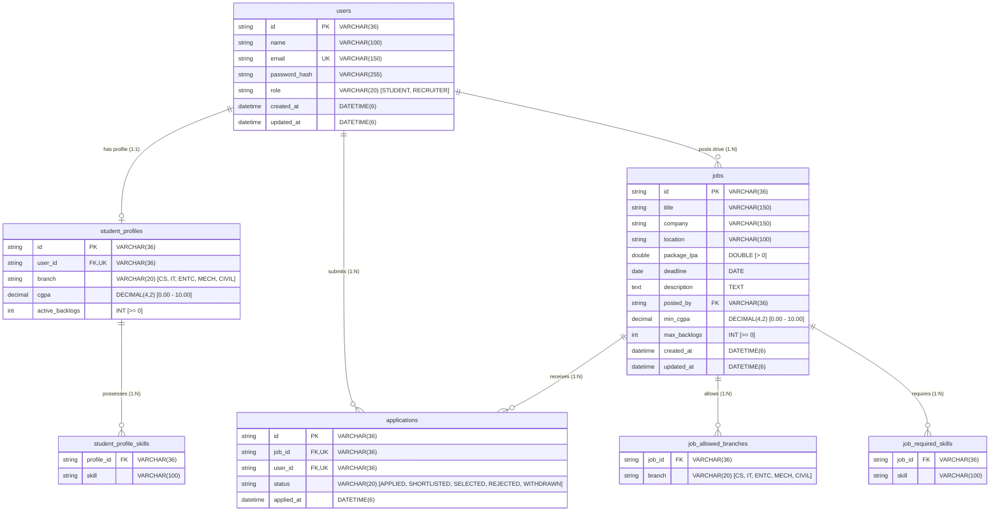
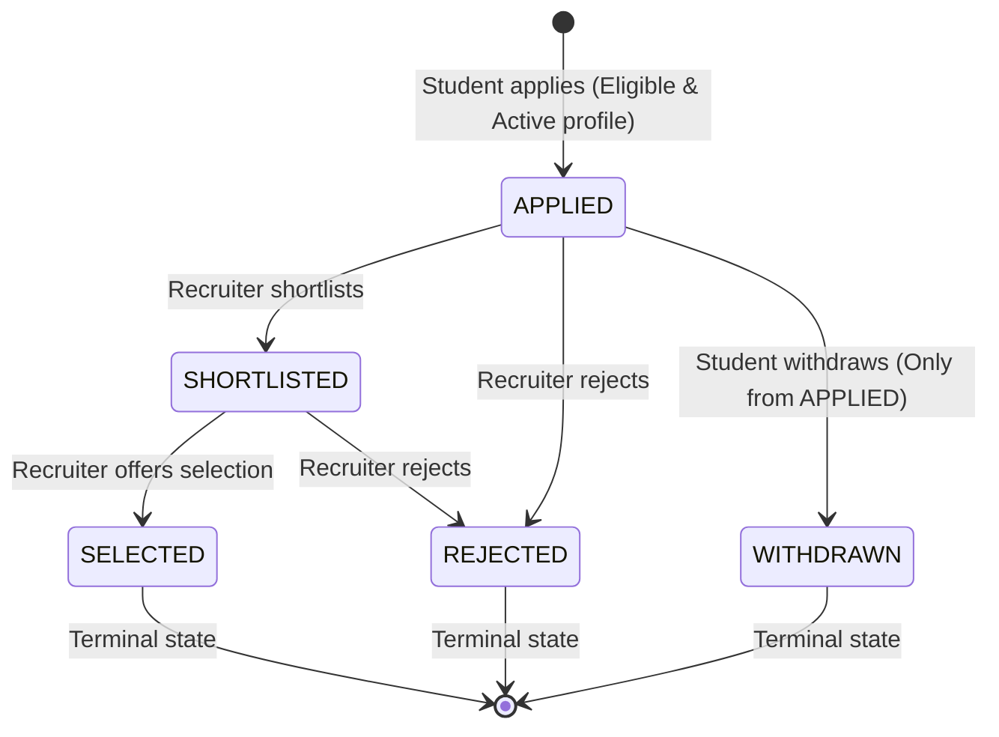

# CampusBridge Database Architecture & Schema Specification

This document details the complete relational database design for **CampusBridge — Intelligent Campus Recruitment & Career Intelligence Platform**.

---

## 1. Architecture Overview

- **Database Engine:** MySQL 8.0+
- **Default Database Name:** `campusbridge`
- **Character Set & Collation:** `utf8mb4` / `utf8mb4_0900_ai_ci`
- **Migration Framework:** Flyway (`src/main/resources/db/migration`)
- **Object-Relational Mapping (ORM):** Spring Data JPA / Hibernate ORM 7.4
- **Primary Key Strategy:** Universally Unique Identifiers (`VARCHAR(36)` / UUID v4) ensuring secure, non-sequential, distributed-safe identifiers.

---

## 2. Entity-Relationship Diagram (ERD)



---

## 3. Table Schema & Column Definitions

### 3.1. `users` Table
Stores authentication credentials and high-level role authorization.

| Column | Type | Nullable | Default | Description |
|---|---|---|---|---|
| `id` | VARCHAR(36) | NO | — | Primary Key (UUID) |
| `name` | VARCHAR(100) | NO | — | User's full display name |
| `email` | VARCHAR(150) | NO | — | Unique login email (lowercase) |
| `password_hash` | VARCHAR(255) | NO | — | BCrypt-hashed password |
| `role` | VARCHAR(20) | NO | — | Role: `STUDENT` or `RECRUITER` |
| `created_at` | DATETIME(6) | NO | CURRENT_TIMESTAMP(6) | Registration timestamp |
| `updated_at` | DATETIME(6) | NO | CURRENT_TIMESTAMP(6) | Timestamp of last profile update |

**Constraints & Indexes:**
- `pk_users`: `PRIMARY KEY (id)`
- `uq_users_email`: `UNIQUE (email)` — Prevents duplicate registrations.
- `ck_users_role`: `CHECK (role IN ('STUDENT', 'RECRUITER'))` — Restricts roles to domain values.

---

### 3.2. `student_profiles` Table
Stores academic metrics for registered student candidates.

| Column | Type | Nullable | Default | Description |
|---|---|---|---|---|
| `id` | VARCHAR(36) | NO | — | Primary Key (UUID) |
| `user_id` | VARCHAR(36) | NO | — | Foreign Key referencing `users(id)` |
| `branch` | VARCHAR(20) | NO | — | Engineering branch |
| `cgpa` | DECIMAL(4,2) | NO | — | Cumulative Grade Point Average |
| `active_backlogs` | INT | NO | 0 | Count of active academic arrears |

**Constraints & Indexes:**
- `pk_student_profiles`: `PRIMARY KEY (id)`
- `uq_student_profiles_user_id`: `UNIQUE (user_id)` — Enforces strict 1:1 relationship with `users`.
- `fk_student_profiles_user_id`: `FOREIGN KEY (user_id) REFERENCES users(id) ON DELETE CASCADE`
- `ck_student_profiles_branch`: `CHECK (branch IN ('CS', 'IT', 'ENTC', 'MECH', 'CIVIL'))`
- `ck_student_profiles_cgpa`: `CHECK (cgpa >= 0.0 AND cgpa <= 10.0)` — Numerical grade boundary.
- `ck_student_profiles_active_backlogs`: `CHECK (active_backlogs >= 0)`

---

### 3.3. `student_profile_skills` Table
Normalized table storing skills possessed by a student.

| Column | Type | Nullable | Default | Description |
|---|---|---|---|---|
| `profile_id` | VARCHAR(36) | NO | — | Foreign Key referencing `student_profiles(id)` |
| `skill` | VARCHAR(100) | NO | — | Technical competency keyword |

**Constraints & Indexes:**
- `fk_student_profile_skills_profile_id`: `FOREIGN KEY (profile_id) REFERENCES student_profiles(id) ON DELETE CASCADE`
- `idx_student_profile_skills_profile_id`: `INDEX (profile_id)` — Optimizes profile skill retrieval.

---

### 3.4. `jobs` Table
Campus placement vacancies posted by recruiters.

| Column | Type | Nullable | Default | Description |
|---|---|---|---|---|
| `id` | VARCHAR(36) | NO | — | Primary Key (UUID) |
| `title` | VARCHAR(150) | NO | — | Position title |
| `company` | VARCHAR(150) | NO | — | Hiring organization name |
| `location` | VARCHAR(100) | NO | — | Placement / work location |
| `package_lpa` | DOUBLE | NO | — | Annual package compensation in LPA |
| `deadline` | DATE | NO | — | Application closing date |
| `description` | TEXT | NO | — | Role description and responsibilities |
| `posted_by` | VARCHAR(36) | YES | NULL | Foreign Key referencing `users(id)` |
| `min_cgpa` | DECIMAL(4,2) | NO | — | Eligibility threshold for CGPA |
| `max_backlogs` | INT | NO | — | Maximum permitted active backlogs |
| `created_at` | DATETIME(6) | NO | CURRENT_TIMESTAMP(6) | Posting timestamp |
| `updated_at` | DATETIME(6) | NO | CURRENT_TIMESTAMP(6) | Modification timestamp |

**Constraints & Indexes:**
- `pk_jobs`: `PRIMARY KEY (id)`
- `fk_jobs_posted_by`: `FOREIGN KEY (posted_by) REFERENCES users(id) ON DELETE SET NULL` — Preserves job drive archive even if recruiter leaves.
- `ck_jobs_package_lpa`: `CHECK (package_lpa > 0)` — Compensation must be positive.
- `ck_jobs_min_cgpa`: `CHECK (min_cgpa >= 0.0 AND min_cgpa <= 10.0)`
- `ck_jobs_max_backlogs`: `CHECK (max_backlogs >= 0)`
- `idx_jobs_posted_by`: `INDEX (posted_by)` — Fast queries for recruiter dashboards.
- `idx_jobs_deadline`: `INDEX (deadline)` — Fast sorting of open opportunities.

---

### 3.5. `job_allowed_branches` Table
Normalized relation table for allowed departments per job vacancy.

| Column | Type | Nullable | Default | Description |
|---|---|---|---|---|
| `job_id` | VARCHAR(36) | NO | — | Foreign Key referencing `jobs(id)` |
| `branch` | VARCHAR(20) | NO | — | Permitted branch value |

**Constraints & Indexes:**
- `fk_job_allowed_branches_job_id`: `FOREIGN KEY (job_id) REFERENCES jobs(id) ON DELETE CASCADE`
- `ck_job_allowed_branches_branch`: `CHECK (branch IN ('CS', 'IT', 'ENTC', 'MECH', 'CIVIL'))`
- `idx_job_allowed_branches_job_id`: `INDEX (job_id)`

---

### 3.6. `job_required_skills` Table
Normalized relation table for required skills per job opening.

| Column | Type | Nullable | Default | Description |
|---|---|---|---|---|
| `job_id` | VARCHAR(36) | NO | — | Foreign Key referencing `jobs(id)` |
| `skill` | VARCHAR(100) | NO | — | Mandatory skill requirement |

**Constraints & Indexes:**
- `fk_job_required_skills_job_id`: `FOREIGN KEY (job_id) REFERENCES jobs(id) ON DELETE CASCADE`
- `idx_job_required_skills_job_id`: `INDEX (job_id)`

---

### 3.7. `applications` Table
Tracks candidate submissions through the campus placement pipeline.

| Column | Type | Nullable | Default | Description |
|---|---|---|---|---|
| `id` | VARCHAR(36) | NO | — | Primary Key (UUID) |
| `job_id` | VARCHAR(36) | NO | — | Foreign Key referencing `jobs(id)` |
| `user_id` | VARCHAR(36) | NO | — | Foreign Key referencing `users(id)` |
| `status` | VARCHAR(20) | NO | — | Pipeline status |
| `applied_at` | DATETIME(6) | NO | CURRENT_TIMESTAMP(6) | Application submission timestamp |

**Constraints & Indexes:**
- `pk_applications`: `PRIMARY KEY (id)`
- `fk_applications_job_id`: `FOREIGN KEY (job_id) REFERENCES jobs(id) ON DELETE RESTRICT` — Preserves application audit history if job is deleted.
- `fk_applications_user_id`: `FOREIGN KEY (user_id) REFERENCES users(id) ON DELETE RESTRICT` — Preserves application audit history if student user is deleted.
- `ck_applications_status`: `CHECK (status IN ('APPLIED', 'SHORTLISTED', 'SELECTED', 'REJECTED', 'WITHDRAWN'))`
- `uq_applications_job_user`: `UNIQUE (job_id, user_id)` — **Crucial business rule:** Prevents duplicate applications for the same job and student.
- `idx_applications_job_id`: `INDEX (job_id)` — Look up applicants for a vacancy.
- `idx_applications_user_id`: `INDEX (user_id)` — Look up student application history.
- `idx_applications_status`: `INDEX (status)` — Filter candidates by recruitment stage.

---

## 4. Application Lifecycle & State Machine



### Business Rules Enforced
1. **Submission Preconditions:**
   - Student academic profile must exist and be complete.
   - Current time must precede `deadline + 23:59:59`.
   - Candidate must satisfy branch, CGPA, backlogs, and skills eligibility criteria.
   - Unique constraint `uq_applications_job_user` prevents concurrent duplicate applications.
2. **Student Withdrawal:**
   - A student may only withdraw an application when its status is `APPLIED`.
   - Once `SHORTLISTED`, `SELECTED`, or `REJECTED`, the application cannot be withdrawn.
3. **Status Transitions:**
   - Only the recruiter who posted the job can update candidate statuses.
   - Terminal states (`SELECTED`, `REJECTED`, `WITHDRAWN`) cannot transition to any other status.

---

## 5. Normalization Analysis

- **First Normal Form (1NF):**
  All columns contain atomic values. Multi-valued attributes (student skills, allowed branches, required skills) are extracted into distinct relational tables (`student_profile_skills`, `job_allowed_branches`, `job_required_skills`).
- **Second Normal Form (2NF):**
  Every non-key attribute is fully functionally dependent on the primary key. UUID surrogate primary keys ensure no partial key dependencies exist.
- **Third Normal Form (3NF):**
  No transitive dependencies exist. Attributes depend directly on the primary key of their respective tables.
- **Boyce-Codd Normal Form (BCNF):**
  For every functional dependency $X \rightarrow Y$, $X$ is a superkey.

---

## 6. Flyway Migration History

| Version | File | Description | Impact |
|---|---|---|---|
| **V1** | `V1__create_users.sql` | Create users table | Core authentication & role grants (`STUDENT`, `RECRUITER`) |
| **V2** | `V2__create_student_profiles.sql` | Create student_profiles table | Academic metrics, CGPA boundaries, and branch constraints |
| **V3** | `V3__create_skills.sql` | Create student_profile_skills relation | Normalized skills collection for student profiles |
| **V4** | `V4__create_jobs.sql` | Create jobs & eligibility relations | Job vacancies, compensation, deadlines, allowed branches & required skills |
| **V5** | `V5__create_applications.sql` | Create applications table | Application records, lifecycle statuses, and `uq_applications_job_user` unique constraint |
| **V6** | `V6__schema_hardening.sql` | Schema hardening & integrity enforcement | Convert CGPA/min_CGPA to DECIMAL(4,2), rename password to password_hash, ON DELETE RESTRICT on applications |

---

## 7. Migration Verification Procedures

### Running Migrations via Maven
```powershell
# In backend directory
.\mvnw.cmd test
```
Flyway automatically executes all pending migrations in `backend/src/main/resources/db/migration/` upon application startup, validates existing tables against `flyway_schema_history`, and verifies that Hibernate entities match the schema.

### Verifying Flyway Status in MySQL
```sql
USE campusbridge;
SELECT installed_rank, version, description, type, script, success, installed_on 
FROM flyway_schema_history;
```
